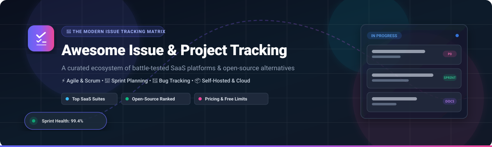

# 🚀 Awesome Issue & Project Tracking Software

**A comprehensive, curated index of premier SaaS platforms and top-starred open-source GitHub repositories for Agile Issue Tracking, Sprint Management, Bug Tracking, and Self-Hosted Workflows.**

---

## 🧭 Table of Contents

- [📊 Sector Overview & Market Dynamics](#-sector-overview--market-dynamics)
- [☁️ Top SaaS & Hosted Platforms](#️-top-saas--hosted-platforms)
- [📦 Top Open-Source GitHub Projects](#-top-open-source-github-projects)
- [🤝 How to Contribute](#-how-to-contribute)
- [💖 Support](#-support)
- [📈 Star History](#-star-history)
- [⚖️ Disclaimer & Evaluation Guidelines](#️-disclaimer--evaluation-guidelines)

---

## 📊 Sector Overview & Market Dynamics

The global **Issue Tracking and Project Management Software** market represents a massive, rapidly expanding sector valued at approximately **$9.5 billion to $11.0 billion in 2025–2026**, with compound annual growth rates (CAGR) sustained between **11% and 14%**. The broader ecosystem is **moderately fragmented**: while dominant legacy and enterprise giants (such as Microsoft/GitHub, Atlassian, and Monday.com) capture massive corporate spending, the sector does **not** follow a strict winner-take-all dynamic. Instead, rapid product iteration and methodology specializations have fostered high demand for hyper-specialized tools—ranging from keyboard-first developer speed champions (Linear) and flexible no-code work operating systems (ClickUp, Asana) to deeply customizable, privacy-first, and self-hosted open-source alternatives (Plane, OpenProject).

---

## ☁️ Top SaaS & Hosted Platforms

Below is a detailed breakdown of category-leading SaaS issue and project tracking solutions. The table is **sorted in descending order by company scale** (market capitalization, parent valuation, or most recent private valuation).

| 🏢 Platform | 💰 Company Scale (Valuation / Revenue) | 🏷️ Starting Tier Pricing | 🎁 Free Tier Limits / Free Trial Plan | 🎯 Key Capabilities & Best For |
| :--- | :--- | :--- | :--- | :--- |
| **[GitHub Issues](https://github.com/features/issues)** | **~$3.1 Trillion** *(Parent: Microsoft / $1B+ ARR)* | **$4.00** / user / month (Team plan) | **Free Forever**: Unlimited public/private repositories, unlimited collaborators, 500 MB Actions storage, 2,000 Actions minutes/month | Deep native integration with git repos, pull requests, automated project tables, labels, and issue forms. Best for developer-centric teams. |
| **[Jira](https://www.atlassian.com/software/jira)** | **~$45 Billion** *(Atlassian public cap / ~$4.4B ARR)* | **$7.16 – $8.48** / user / month (Standard plan) | **Free Forever**: Up to **10 users**, 2 GB total storage, 100 automation runs/month, community support, Scrum & Kanban boards | Enterprise-grade issue tracking, extensive workflows, release roadmaps, and vast Atlassian marketplace integration. Standard for large-scale IT and engineering. |
| **[Monday.com](https://monday.com/)** | **~$14.5 Billion** *(Market Cap / ~$970M ARR)* | **$9.00** / user / month *(billed annually, min 3 seats)* | **Free Forever**: Up to **2 seats**, maximum **3 boards**, 200 items/tasks total, 500 MB storage | Highly visual and customizable Work OS with automation, multi-department status boards, and workload tracking. Best for cross-functional project tracking. |
| **[Asana](https://asana.com/)** | **~$3.2 Billion** *(Market Cap / ~$700M ARR)* | **$10.99** / user / month (Starter plan, billed annually) | **Free Forever**: Up to **2 collaborators** (with unlimited read-only guests), unlimited tasks and projects, 100 MB per file attachment | Structured task and project management with timeline views, dependency maps, portfolio overviews, and executive dashboards. Best for collaborative corporate teams. |
| **[Linear](https://linear.app/)** | **$2.5 Billion** *(Aug 2026 secondary tender / $100M+ ARR)* | **$10.00** / user / month (Basic plan, billed annually) | **Free Forever**: Up to **250 active (non-archived) issues**, **2 teams**, unlimited members, 10 MB file uploads | High-speed, keyboard-first issue tracker with cycles, automated triage, and sleek UX. Revered by modern tech startups, product engineers, and designers. |
| **[Wrike](https://www.wrike.com/)** | **~$2.25 Billion** *(STG / former Citrix acquisition valuation)* | **$10.00** / user / month (Team plan, billed annually) | **Free Forever**: **Unlimited users**, capped at **200 active tasks/subtasks**, 2 GB total storage, 1 shared space, basic board & table views | Enterprise collaborative work management with interactive Gantt charts, custom request forms, and resource capacity management. |
| **[ClickUp](https://clickup.com/)** | **$4.0 Billion** *(Series C valuation / $160M+ ARR)* | **$7.00** / user / month (Unlimited plan, billed annually) | **Free Forever**: **Unlimited users/members**, 100 MB total storage, 100 automation runs/month, unlimited tasks (lifetime limits on advanced Gantt/Dashboards) | All-in-one productivity suite unifying tasks, docs, whiteboard, chat, and multiple views (Board, Gantt, Calendar, Mind Maps). Best for tool consolidation. |
| **[Shortcut](https://shortcut.com/)** | **~$100 Million** *(Series B post-money valuation)* | **$8.50** / user / month (Team plan, billed annually) | **Free Forever**: Up to **10 users**, **1 team & 1 workspace**, unlimited stories and docs, sprint cycles, standard GitHub/Slack integrations | Agile project management balancing speed and sprint structure; epics, iterations, and developer roadmaps without Jira's configuration bloat. |

---

## 📦 Top Open-Source GitHub Projects

The open-source issue and project tracking ecosystem offers mature alternatives to closed-source SaaS offerings—from sleek modern kanban boards to full-featured classical ERP/ALM suites. 

The repositories below are **ranked in descending order by GitHub Stars_Count**, equipped with direct social badges linking to each repository's stargazers.

| 🏆 Project | 🌟 GitHub_Stars_Badge | 📜 License | 🛠️ Tech Stack | 💡 Focus & Key Architecture |
| :--- | :--- | :--- | :--- | :--- |
| **[Plane](https://github.com/makeplane/plane)** |  | AGPL-3.0 | TypeScript, Python (Django), Next.js | Modern open-source Jira & Linear replacement. Delivers cycles (sprints), modules, triage, rich-text docs, and issue matrices with Kanban and Gantt views. |
| **[Focalboard](https://github.com/mattermost-community/focalboard)** |  | AGPL-3.0 | Go, TypeScript, React | Multilingual Trello/Notion/Asana alternative developed by Mattermost. Provides Kanban boards, tables, galleries, and task management (*Note: standalone version unmaintained; best via Mattermost Boards plugin*). |
| **[Huly Platform](https://github.com/hcengineering/platform)** |  | EPL-2.0 | TypeScript, React, Node.js | All-in-one extensible workspace replacing Linear, Jira, Slack, and Notion with unified project management, audio rooms, collaborative documents, and issue trackers. |
| **[Wekan](https://github.com/wekan/wekan)** |  | MIT | JavaScript, Meteor, Node.js | Battle-tested, privacy-focused open-source collaborative Kanban board application available in dozens of languages; easy one-click self-hosting via Docker and Snap. |
| **[OpenProject](https://github.com/opf/openproject)** |  | GPL-3.0 | Ruby on Rails, Angular | The most comprehensive classical open-source project management suite. Includes drag-and-drop Gantt timelines, Agile sprint boards, cost budgeting, and resource management. |
| **[Phabricator](https://github.com/phacility/phabricator)** |  | Apache-2.0 | PHP | Legendary monorepo issue tracking, code review, and project management suite originally created at Facebook (*Upstream frozen; see community-maintained fork **[Phorge](https://github.com/phorgeit/phorge)** for active development*). |
| **[Leantime](https://github.com/Leantime/leantime)** |  | AGPL-3.0 | PHP, Vue.js | Strategic, goals-focused open-source project management platform tailored for non-project managers, ADHD minds, and startups with Kanban boards, milestones, and idea boards. |
| **[Kanboard](https://github.com/kanboard/kanboard)** |  | MIT | PHP, SQLite/MySQL | Minimalist, zero-fuss self-hosted Kanban board software with strict WIP limits, automatic actions, subtasks, and minimal resource footprint. |
| **[Kaneo](https://github.com/usekaneo/kaneo)** |  | AGPL-3.0 | TypeScript, Next.js, Node.js | Modern, lightweight project management application featuring clean Kanban boards, Gantt charts, GitHub synchronization, and self-hosted Docker deployment. |
| **[Redmine](https://github.com/redmine/redmine)** |  | GPL-2.0 | Ruby on Rails | Veteran open-source multi-project tracker with 20+ years of active stability. Supports cross-project issue tracking, flexible role-based access control, Gantt charts, and a massive community plugin ecosystem. |
| **[Vikunja](https://github.com/go-vikunja/vikunja)** |  | AGPL-3.0 | Go, TypeScript, Vue.js | Snappy, self-hosted to-do and project management platform with multiple views (List, Kanban, Table, Gantt), subtasks, attachments, and collaborative namespaces. |
| **[Taskcafe](https://github.com/JordanKnott/taskcafe)** |  | MIT | Go, React, TypeScript | Clean, modern open-source Trello/Nextcloud alternative project management tool featuring intuitive Kanban boards, checklist items, and task assignments. |
| **[Restyaboard](https://github.com/RestyaPlatform/board)** |  | OSL-3.0 | PHP, JavaScript | Enterprise-ready Kanban board based on the Restya platform, supporting card conversions, board templates, time tracking, and chat integrations. |
| **[MantisBT](https://github.com/mantisbt/mantisbt)** |  | GPL-2.0 | PHP | Classic, reliable web-based bug and defect tracking system that provides straightforward issue lifecycles, email notifications, and revision control integration. |
| **[Bugzilla](https://github.com/bugzilla/bugzilla)** |  | MPL-2.0 | Perl | Mozilla's historic defect-tracking system designed for enterprise-scale software projects with granular advanced query search, comprehensive bug dependencies, and strict audit trails. |
| **[Taiga Back](https://github.com/taigaio/taiga-back)** |  | MPL-2.0 | Python (Django) | Dedicated open-source Agile project management platform built specifically for Scrum ceremonies, story points, sprint burndown charts, and epics. |

---

## 🤝 How to Contribute

We welcome additions, corrections, and ecosystem updates from engineers and open-source maintainers worldwide!

1. 🍴 **Fork the Repository** to your personal GitHub account.
2. 🌿 **Create a New Branch** (`git checkout -b feature/add-new-tracker`).
3. ✏️ **Update the Documentation** in `README.md`:
   - Adhere to the established Markdown tables and social badge styling conventions.
   - Include factual starting-tier pricing, exact free tier limitations, and verified GitHub star metrics.
4. 🔍 **Verify Links & Data** to ensure URLs are canonical and markdown renders cleanly.
5. 🚀 **Submit a Pull Request** with a concise description of your changes.

## 💖 Support

Thank you for visiting and using this curated directory! If you find this resource helpful for evaluating, choosing, or deploying issue tracking and project management tools, please consider supporting the project:

- ⭐ **Star this repository** on GitHub to help others discover it.
- 🍴 **Fork and contribute** by adding new tools, updating pricing tiers, or submitting corrections.
- 📢 **Share with colleagues**, engineering managers, product leads, and communities.
- ☕ **Sponsor the work**: You can buy me a coffee or become a recurring sponsor via the [GitHub Sponsor Dashboard](https://github.com/sponsors/ishandutta2007).

---

## 📈 Star History

---

## ⚖️ Disclaimer & Evaluation Guidelines

- 🛡️ **Community Curated**: This repository is maintained as an open-source educational directory and does not constitute a formal commercial endorsement.
- 🔐 **Security & Operational Ownership**: Self-hosting issue tracking infrastructure transfers total responsibility for database backup replication, RBAC permissions, and vulnerability patching onto your organization.
- 📜 **Licensing Review**: Always review licensing parameters (e.g., AGPL-3.0, GPL-3.0, MIT, Apache-2.0) prior to enterprise deployment or bundling with proprietary distribution pipelines.

---

**[⬆ Back to Top](#-awesome-issue--project-tracking-software)**

